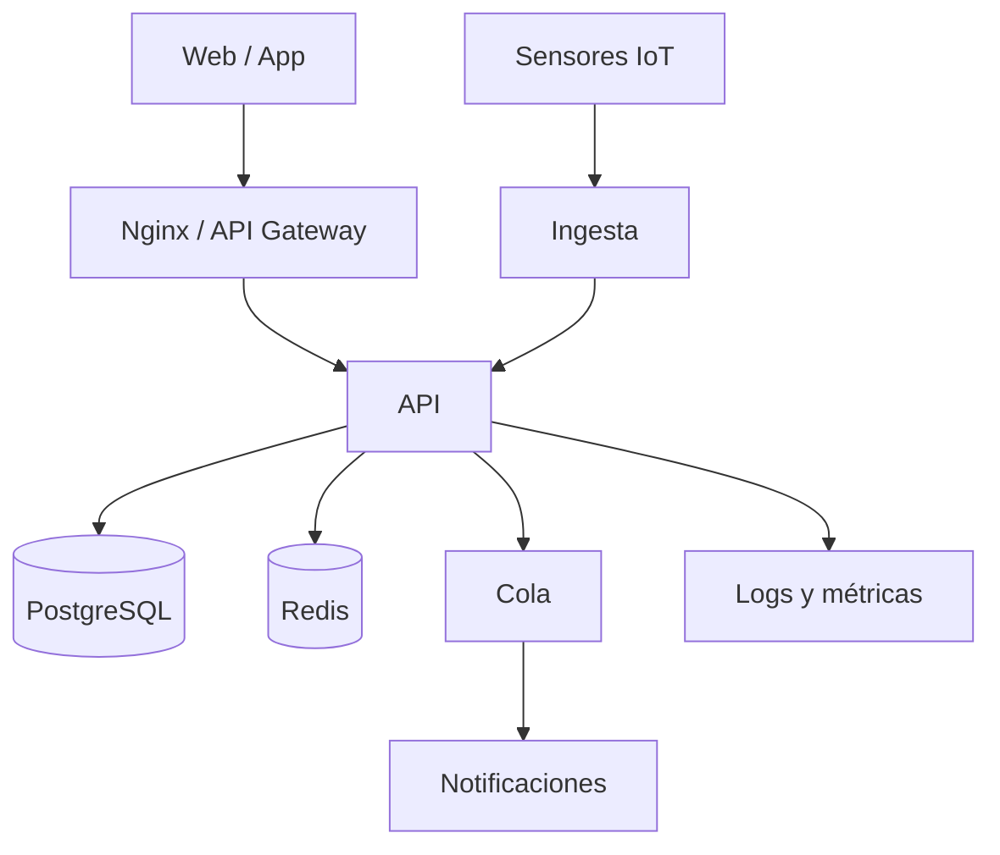

# SmartCampus — Workshop 2: arquitectura

Nginx enruta y termina TLS; API valida reglas; PostgreSQL conserva usuarios/aulas/reservas; Redis almacena caché temporal; cola desacopla eventos; observabilidad recoge logs y métricas. REST sirve para CRUD. Las API deben ser stateless para replicarse.
Endpoints: `GET /rooms`, `GET /rooms/{id}/availability`, `POST /reservations`, `DELETE /reservations/{id}`, `POST /telemetry`, `GET /alerts`.
