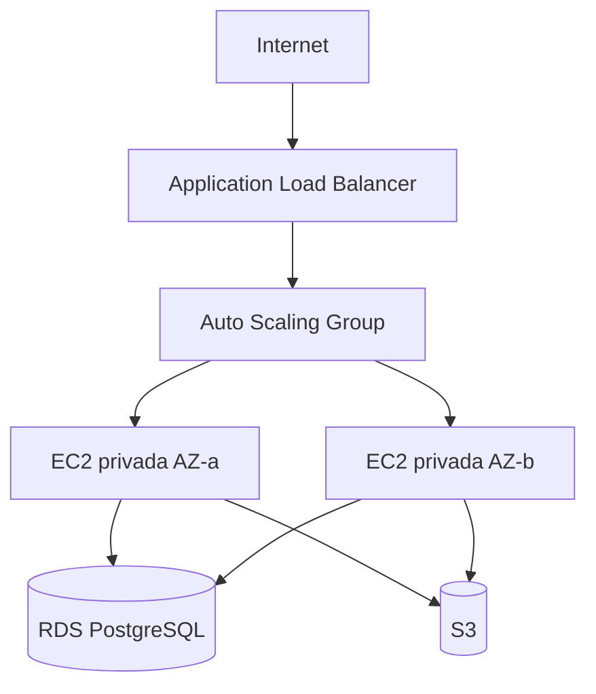

# Taller 6 — Una arquitectura que pueda crecer

La idea es no depender de una sola EC2. Un Application Load Balancer reparte las peticiones entre varias instancias y Auto Scaling agrega o quita máquinas según la carga. Poner instancias en más de una zona ayuda si una zona tiene problemas. Las APIs deberían ser stateless; los archivos se pueden guardar en S3 y los datos en una base administrada como RDS.

